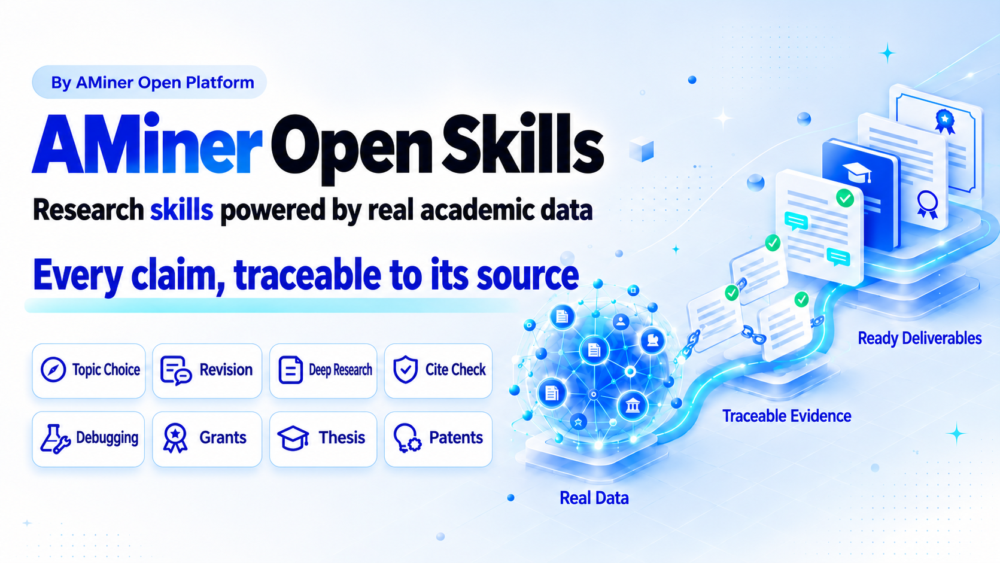

<div align="center">
  <h1>AMiner Open Skills</h1>
  <p>
    <a href="LICENSE"></a>
    <a href=".claude-plugin/marketplace.json"></a>
    <a href="#2-skill-index"></a>
    <a href="#3-installation"></a>
    <a href="README.md"></a>
  </p>
  <p>
    <a href="https://www.aminer.cn/">Website</a>
    · <a href="#1-quick-start">Quick Start</a>
    · <a href="#2-skill-index">Skill Index</a>
    · <a href="#3-installation">Install</a>
    · <a href="https://open.aminer.cn/open/docs">Open Platform Docs</a>
    · <a href="#4-design-principles-and-repository-layout">Design Principles</a>
    · <a href="README.md">中文</a>
  </p>
  <p>
    
  </p>
  <p>
    <b>AMiner web app: Smart Search, AI Reading, Res Labs, AI2000 and more built in — visit <a href="https://www.aminer.cn">https://www.aminer.cn</a></b>
  </p>
</div>

---

`aminer-open-skill` collects reusable research skills built on AMiner academic data for the full research lifecycle, emphasizing real academic data, verifiable evidence chains, and directly usable research artifacts.

## Contents

- [1. Quick Start](#1-quick-start)
- [2. Skill Index](#2-skill-index)
  - [2.1 Choosing between similar skills](#21-choosing-between-similar-skills)
  - [2.2 Full skill list](#22-full-skill-list)
- [3. Installation](#3-installation)
  - [3.1 `npx skills` (recommended)](#31-npx-skills-recommended)
  - [3.2 Claude Code plugin](#32-claude-code-plugin)
  - [3.3 Manual install (Codex / OpenClaw / other agents)](#33-manual-install-codex--openclaw--other-agents)
  - [3.4 Python dependencies](#34-python-dependencies)
  - [3.5 Configure the token when required](#35-configure-the-token-when-required)
  - [3.6 Token and billing notes](#36-token-and-billing-notes)
- [4. Design Principles and Repository Layout](#4-design-principles-and-repository-layout)
- [5. Feedback and Contact](#5-feedback-and-contact)
- [6. Star History](#6-star-history)

## 1. Quick Start

Hand your papers, topics, reviewer comments, or task descriptions straight to the agent — the prompts below can be copied as-is. Every skill here is listed in the [2.2 full skill list](#22-full-skill-list). The first 7 research workflow skills need no installation — click "Try online" to open them directly in the AMiner web app; the rest target local agents, see [3. Installation](#3-installation):

| Task | Example prompt | Try&nbsp;online |
|---|---|---|
| Paper deep reading | `Deep-read "Attention Is All You Need": summarize the problem, method, experimental design, and key numbers, and suggest directions for further exploration.` (`aminer-paper-deep-reading`) | [](https://www.aminer.cn/?skill=aminer-paper-deep-reading) |
| Journal manuscript writing, review, and revision | `Write the Related Work section for this manuscript with real retrieved citations behind every claim, then simulate a peer review round.` (`aminer-journal-paper-write-review-revise`) | [](https://www.aminer.cn/?skill=aminer-journal-paper-write-review-revise) |
| From experiments to manuscript | `My experiment cannot reproduce the numbers reported in this paper — help me debug it, and verify the literature basis for this metric.` (`aminer-experiment-to-paper`) | [](https://www.aminer.cn/?skill=aminer-experiment-to-paper) |
| Thesis proposal to defense | `Do the literature scan and novelty check for my thesis proposal, then work through my advisor's comments on Chapter 2 one by one.` (`aminer-degree-thesis-proposal-to-defense`) | [](https://www.aminer.cn/?skill=aminer-degree-thesis-proposal-to-defense) |
| Project application | `Extract the application requirements from this guideline, help me distill the scientific question and draft section by section, then review the proposal as an expert panel.` (`aminer-grant-application`) | [](https://www.aminer.cn/?skill=aminer-grant-application) |
| Research topic and advisor selection | `Assess the level of competition in "retrieval-augmented generation for industrial defect detection" and run a novelty check on the topic.` (`aminer-topic-advisor-selection`) | [](https://www.aminer.cn/?skill=aminer-topic-advisor-selection) |
| Industry intelligence and patents | `Produce a technology survey of solid-state electrolytes, and retrieve the closest prior art published before this filing date.` (`aminer-patent-tech-intelligence`) | [](https://www.aminer.cn/?skill=aminer-patent-tech-intelligence) |
| Quick paper lookup | `Find 10 recent papers on long-context language models. Return the title, year, venue, citation count, and URL.` (`aminer-free-academic`) | — |
| Investigate a scholar or topic | `Build a research profile for Andrew Ng, including interests, representative papers, collaborators, and recent work.` (`aminer-academic-search`) | — |
| Retrieve structured experiments | `Return the original Experiment JSON for this paper, filtered by method and dataset name.` (`aminer-academic-search`) | — |
| Get a focused reading list | `Recommend 8 papers on tool-using multimodal agents, prioritizing recent and highly cited work.` (`aminer-daily-paper`) | — |
| Collect literature for a survey | `Collect 200 candidate papers on retrieval-augmented generation, expand from strong seed papers, remove duplicates, and export the bibliography.` (`aminer-deep-search`) | — |
| Organize a paper collection | `Group these paper titles and abstracts into a coherent hierarchical taxonomy and save it as taxonomy.md.` (`scientific-taxonomy`) | — |
| Produce a sourced research report | `Research the Chinese LLM industry and write a cited report with an evidence ledger backing every claim.` (`deep-research`) | — |
| Find SOTA and build a leaderboard | `Find the current DocVQA SOTA, separate incompatible evaluation scopes, and return a sourced leaderboard with the standard artifact bundle.` (`sota-finder`) | — |
| Check experimental baseline coverage | `Check whether this paper may be missing direct experimental baselines, and separate evidence-backed comparisons from leads that need author verification.` (`baseline-finder`) | — |
| Trace a paper's sources | `Analyze this PDF. Trace each key claim to its citation context and source, explain the citation intent, and generate the Markdown, JSON, SVG, and HTML outputs.` (`paper-source-trace`) | — |
| Parse a PDF and extract experiments | `OCR this paper PDF, convert it to Markdown, and extract the experiment methods, datasets, and metrics as JSON.` (`aminer-pdf-ocr`) | — |
| Extract experiments from Markdown | `Read this paper's Markdown file and extract the experiment methods, datasets, metrics, and key results as one JSON file.` (`aminer-exp-extraction`) | — |
| Detect fabricated references | `Check every reference in this paper PDF and flag entries that are missing, suspicious, or need manual review.` (`pdf-citation-verifier`) | — |
| Audit parsed bibliography entries conservatively | `Parse this PDF into a reference ledger, then resolve each eligible reference through AMiner without treating an unresolved match as fabrication.` (`structured-reference-audit`) | — |
| Check citation faithfulness | `For each in-text citation in this paper, retrieve the cited source and determine whether the surrounding claim is supported by the original text.` (`citation-faithfulness`) | — |

If you are not sure which skill fits, just describe the task; if you already know the name, state it explicitly, e.g. "use `aminer-free-academic`". When installed as a [Claude Code plugin](#32-claude-code-plugin), skills with a `commands/` directory can also be invoked as slash commands (plugin commands carry the plugin-name prefix):

```text
/aminer-deep-search:aminer-deep-search topic: "multimodal agents" target-size: 200
```

## 2. Skill Index

### 2.1 Choosing between similar skills

| Your need | Use | Not |
|---|---|---|
| A single-step lookup of papers, scholars, institutions, venues, or patents, at zero cost | `aminer-free-academic` | `aminer-academic-search` (only for full abstracts, scholar careers, citation relations, or combined workflows) |
| A list of hundreds of candidate papers, without a report | `aminer-deep-search` | `deep-research` |
| A cited research report backed by an evidence ledger | `deep-research` | `aminer-deep-search` |
| A few personalized reading recommendations | `aminer-daily-paper` | `aminer-deep-search` |
| A direct verdict on whether references exist | `pdf-citation-verifier` | `structured-reference-audit` |
| A conservative reference audit where "unresolved" is not "fabricated" | `structured-reference-audit` | `pdf-citation-verifier` |
| Whether a citation faithfully represents the cited source | `citation-faithfulness` | `pdf-citation-verifier` |
| Tracing claims to sources and citation intent, with a citation map | `paper-source-trace` | `citation-faithfulness` |
| Audit potentially missing direct experimental baselines | `baseline-finder` | `aminer-deep-search` (it gathers candidate papers; it does not assess baseline coverage) |
| Convert a PDF to full-text Markdown | `aminer-pdf-ocr` | `aminer-exp-extraction` (only when the input is already Markdown) |

### 2.2 Full skill list

`skills/` currently contains the following 21 triggerable skills. Click a skill name for the full skill definition. The first 7 are research workflow skills, available online in the AMiner web app; the rest target local agents and are grouped by research stage.

| Skill | Status | Purpose | Triggers | Token |
| --- | --- | --- | --- | --- |
| **Research workflows (available online in the web app)** | | | | |
| [`aminer-paper-deep-reading`](skills/aminer-paper-deep-reading/SKILL.md) | Stable | Paper deep reading: structured close reading, sentence-by-sentence translation, reproduction-grade protocol audits; also cross-literature parameter tables and locating papers from vague descriptions | "deep-read this paper", "what is the typical value of X" | Required; free-first |
| [`aminer-journal-paper-write-review-revise`](skills/aminer-journal-paper-write-review-revise/SKILL.md) | Stable | Journal manuscript writing, review, and revision: drafting from scratch with real citations, simulated review before submission, item-by-item responses to real reviewer comments | "write the Related Work with real citations", "respond to each reviewer comment" | Required; free-first |
| [`aminer-experiment-to-paper`](skills/aminer-experiment-to-paper/SKILL.md) | Stable | From experiments to manuscript: debugging code and experiment designs, verifying method provenance, turning results into paper prose | "my experiment cannot reproduce the reported baseline, help me debug" | Required; free-first |
| [`aminer-degree-thesis-proposal-to-defense`](skills/aminer-degree-thesis-proposal-to-defense/SKILL.md) | Stable | Thesis proposal to defense: literature scan and novelty check, section-by-section drafting against the school template, working through advisor and committee comments, format compliance, defense materials | "do the literature scan for my proposal", "work through my advisor's comments" | Required; free-first |
| [`aminer-grant-application`](skills/aminer-grant-application/SKILL.md) | Stable | Project application: extract requirements from the guideline, distill the scientific question, draft section by section, run a novelty check, simulate the expert panel review | "extract the application requirements from this guideline", "review my proposal as an expert panel" | Required; free-first |
| [`aminer-topic-advisor-selection`](skills/aminer-topic-advisor-selection/SKILL.md) | Stable | Research topic and advisor selection: assess the level of competition, run a novelty check on the topic; enumerate a department's advisors, build profiles, compare, and draft outreach emails | "is this direction still worth pursuing", "list the advisors in this department" | Required; per-advisor `person_detail` ¥1.00/call — converge on free APIs before pulling details |
| [`aminer-patent-tech-intelligence`](skills/aminer-patent-tech-intelligence/SKILL.md) | Stable | Industry intelligence and patents: technology survey reports, benchmark studies, URS/SOP documents; prior-art retrieval (strict filing-date cutoff), claims and disclosure drafting, responses to office actions | "produce a technology survey of X", "retrieve prior art published before this date" | Required; free-first; watch `person_detail` unit price in bulk screening |
| **Search and discovery** | | | | |
| [`aminer-free-academic`](skills/aminer-free-academic/SKILL.md) | Stable | Zero-cost lookup of papers, scholars, institutions, venues, and patents via 7 free APIs | "find this paper by title", "the scholar's research interests and citation counts" | Free APIs, token still required |
| [`aminer-academic-search`](skills/aminer-academic-search/SKILL.md) | Stable | Full academic data queries across papers, scholars, institutions, venues, and patents, plus structured experiment retrieval (29 APIs) | "build a full scholar profile", "return the Experiment JSON" | Required; some APIs billed; experiment retrieval ¥0.10/call |
| [`aminer-daily-paper`](skills/aminer-daily-paper/SKILL.md) | Stable | Personalized paper recommendations by topic, scholar profile, or author | "recommend 8 recent highly-cited papers on X" | Required |
| [`aminer-deep-search`](skills/aminer-deep-search/SKILL.md) | Stable | Collect hundreds of candidate papers for a survey: multi-round search, deduplication, citation snowballing | "collect 200 candidate papers for a survey" | Required |
| [`sota-finder`](skills/sota-finder/SKILL.md) | Stable | Find the current or historical best result (SOTA) on a task, split incomparable scopes, build a sourced leaderboard | "what is the current SOTA on X" | Optional; only for AMiner enrichment |
| **Reading and organizing** | | | | |
| [`aminer-pdf-ocr`](skills/aminer-pdf-ocr/SKILL.md) | Stable | Convert a paper PDF to full-text Markdown and extract experiment methods, datasets, and metrics | "convert this PDF to Markdown" | Required |
| [`aminer-exp-extraction`](skills/aminer-exp-extraction/SKILL.md) | Stable | Extract experiment methods, datasets, metrics, and key results from paper Markdown as JSON | "extract methods / datasets / metrics from this paper's Markdown" | Requires `BIGMODEL_API_KEY`; no AMiner token |
| [`scientific-taxonomy`](skills/scientific-taxonomy/SKILL.md) | Stable | Organize a batch of papers into a clear hierarchical taxonomy (Markdown) from titles and abstracts | "organize these papers into a coherent taxonomy" | Optional; only when AMiner fills missing metadata |
| [`paper-source-trace`](skills/paper-source-trace/SKILL.md) | Stable | Trace a paper's claims to their citation sources, explain citation intent, and generate citation maps | "trace key claims to their sources" | Optional; only for AMiner enrichment |
| **Research reports** | | | | |
| [`deep-research`](skills/deep-research/SKILL.md) | Stable | Write a cited research report where every claim traces back to an evidence ledger | "research the X industry and write a cited report" | Required; free-first, billed APIs capped (¥20 hard stop) |
| **Paper experiment checks** | | | | |
| [`baseline-finder`](skills/baseline-finder/SKILL.md) | Preview | Check a paper's experiments and citations against each other to find baselines it should have compared but didn't | "what baselines may be missing" | Model API key and AMiner token required; some API calls billed; GROBID for PDF mode |
| **Citation checking** | | | | |
| [`pdf-citation-verifier`](skills/pdf-citation-verifier/SKILL.md) | Stable | Verify every reference in a paper PDF actually exists; flag fabricated citations | "are the references in this PDF fabricated" | Required |
| [`structured-reference-audit`](skills/structured-reference-audit/SKILL.md) | Stable | Conservative reference audit: parse the PDF into a ledger, resolve each entry; "unresolved" is not "fabricated" | "conservatively audit the references" | AMiner resolution needs a token; GROBID or TEI required |
| [`citation-faithfulness`](skills/citation-faithfulness/SKILL.md) | Stable | Check each in-text citation actually supports the claim, catching distortions of the cited source | "does citation [12] actually support this claim" | No AMiner token; web access required |

## 3. Installation

Every directory under `skills/` is an independently installable skill. Whichever method you use, keep the full skill directory (`SKILL.md`, `scripts/`, `references/`, etc.) — do not copy `SKILL.md` alone. Then configure the token as described in [3.5](#35-configure-the-token-when-required).

| Your environment | Recommended method |
|---|---|
| Claude Code, Codex, OpenClaw, Cursor, Trae, and other mainstream agents | [3.1 `npx skills`](#31-npx-skills-recommended) |
| Claude Code, with slash commands | [3.2 Plugin](#32-claude-code-plugin) |
| No network install, or a pinned version | [3.3 Manual install](#33-manual-install-codex--openclaw--other-agents) |

### 3.1 `npx skills` (recommended)

Requires [Node.js 18 or later](https://nodejs.org/); no global CLI install needed. List the installable skills first:

```bash
npx skills add AMinerOrg/aminer-open-skill --list
```

Install into the current project (omit `--global`) or for your user (add `--global`). `--agent` accepts values such as `claude-code`, `codex`, `openclaw`, `cursor`, `trae`:

```bash
# Free entry point only, into the current project's Claude Code
npx skills add AMinerOrg/aminer-open-skill --agent claude-code --skill aminer-free-academic --yes

# Several skills, globally for Codex
npx skills add AMinerOrg/aminer-open-skill --global --agent codex \
  --skill aminer-free-academic --skill aminer-academic-search --yes

# Every skill
npx skills add AMinerOrg/aminer-open-skill --global --agent claude-code --skill '*' --yes
```

List and update:

```bash
npx skills list --global
npx skills update --global --yes
```

`npx skills` manages skill files only — see [3.4](#34-python-dependencies) for Python dependencies; slash commands require the [3.2 plugin install](#32-claude-code-plugin).

### 3.2 Claude Code plugin

The repository ships a plugin manifest, [`.claude-plugin/marketplace.json`](.claude-plugin/marketplace.json) (marketplace name `aminer-open-skills`), with one plugin per skill. In Claude Code, run:

```text
/plugin marketplace add AMinerOrg/aminer-open-skill
/plugin install aminer-free-academic@aminer-open-skills
```

For other skills, replace `aminer-free-academic` with a name from the [skill list](#22-full-skill-list), or run only the first line and pick plugins in the `/plugin` UI. To pull new versions:

```text
/plugin marketplace update aminer-open-skills
```

The plugin install also registers each skill's slash commands (its `commands/` directory). They carry the plugin-name prefix, e.g. `/aminer-daily-paper:aminer-dp`, `/aminer-deep-search:aminer-deep-search`.

### 3.3 Manual install (Codex / OpenClaw / other agents)

```bash
git clone https://github.com/AMinerOrg/aminer-open-skill.git ~/ai-skills/aminer-open-skill
```

Put each selected `skills/<skill-name>/` directory, whole, into your agent's skill directory:

| Agent | User-level skill directory | Project-level skill directory |
|---|---|---|
| Claude Code | `~/.claude/skills/` | `<project>/.claude/skills/` |
| Codex | `~/.codex/skills/` | — |
| OpenClaw and other agents | see their docs | see their docs |

Prefer symlinks over copies, so a `git pull` in the clone updates the skills:

```bash
ln -s ~/ai-skills/aminer-open-skill/skills/aminer-free-academic ~/.codex/skills/aminer-free-academic
```

Manual installs do not register slash commands (command files depend on the plugin variable `CLAUDE_PLUGIN_ROOT`); trigger skills with natural language instead.

### 3.4 Python dependencies

Skill scripts need `python3`. Most skills use only the standard library; the following need extra packages:

| Skill | Dependencies |
|---|---|
| `aminer-daily-paper` | PyYAML |
| `aminer-pdf-ocr` | requests, pypdf |
| `aminer-exp-extraction` / `pdf-citation-verifier` / `structured-reference-audit` | requests |
| `deep-research` | matplotlib (report figures) |
| `sota-finder` | openpyxl (Excel export) |
| `baseline-finder` | httpx, openai, pypdf |

The seven research-workflow skills (`aminer-topic-advisor-selection` / `aminer-paper-deep-reading` / `aminer-journal-paper-write-review-revise` / `aminer-experiment-to-paper` / `aminer-degree-thesis-proposal-to-defense` / `aminer-grant-application` / `aminer-patent-tech-intelligence`) depend on the standard library only — no extra installation needed.

```bash
python3 -m pip install -r skills/<skill-name>/requirements.txt
```

`baseline-finder` also provides a standalone CLI. Install the skill directory itself in an isolated environment as described in its [SKILL.md](skills/baseline-finder/SKILL.md); this installs dependencies and registers the `baseline-finder` command.

`structured-reference-audit` also needs a reachable [GROBID](https://github.com/kermitt2/grobid) service or existing TEI files.

### 3.5 Configure the token when required

Generate a token in the [AMiner Console](https://open.aminer.cn/open/board?tab=control), then set `AMINER_API_KEY` in the environment used by your assistant:

```bash
export AMINER_API_KEY="<YOUR_TOKEN>"
```

For local Claude Code, Codex, and similar conversational sessions, the repository provides quick setup tools:

```text
Windows:       tools\setup-aminer-token.cmd
PowerShell:    .\tools\setup-aminer-token.ps1
macOS/Linux:   ./tools/setup-aminer-token.sh
```

OpenClaw uses its own environment configuration:

```bash
openclaw config set env.vars.AMINER_API_KEY "<YOUR_TOKEN>"
```

Standalone CLI commands, CI jobs, and scheduled tasks must set the token where the command runs. Not every skill requires a token — check the Token column of the [skill list](#22-full-skill-list) first.

### 3.6 Token and billing notes

- Never print, log, or commit `AMINER_API_KEY`.
- `aminer-exp-extraction` calls the Zhipu BigModel API instead: set `BIGMODEL_API_KEY` for it (`OPENAI_API_KEY` accepted as fallback). It never uses the AMiner token.
- Free AMiner APIs still require a token. Start with `aminer-free-academic` before using paid APIs.
- Some tasks may incur API charges. Review the estimated cost before approving large searches or expensive calls.
- The setup tools under `tools/` configure local chat sessions only. Set the token separately for OpenClaw, CLI, CI, and scheduled jobs.
- For direct API integration rather than Skill usage, see the [AMiner Open Platform documentation](https://open.aminer.cn/open/docs).

## 4. Design Principles and Repository Layout

### 4.1 Shared design principles

Every skill in this repository follows these principles:

1. **Citation-integrity red line**: only write what was actually retrieved — say "not found" rather than fabricating; every result carries a three-state marker (verified / uncertain / not found).
2. **Academic data first**: queries about papers, scholars, institutions, venues, or patents go through the AMiner Open Platform first; free endpoints first, billed calls estimated before execution.
3. **Triage before action**: similar-looking requests are different task types; classify first, then follow the output contract for that type.
4. **Complete first answer**: the first reply delivers the full artifact for the request type instead of relying on clarifying questions.
5. **Fail loudly**: zero-output silent failures never happen; failures keep the submitted materials, and resending the same message resumes from the breakpoint.
6. **Deliveries carry next steps**: every delivery ends with continuations — dimensions, todos, or the next section.
7. **Parse and echo constraints**: word counts, item counts, year windows, and templates written into an instruction are acceptance criteria; parse and echo them before writing, and state any unfilled quota.
8. **Cross-session state**: returning to the same manuscript, project, or list weeks later is normal; continue incrementally instead of rewriting from scratch.
9. **Artifacts over hearsay**: guide users to paste their real materials (drafts, data, comments, templates) — judge by what was pasted, not what was said.

### 4.2 Repository layout

```text
aminer-open-skill/
├── .claude-plugin/marketplace.json   # Claude plugin manifest
├── tools/                            # quick token-setup scripts for local sessions
└── skills/
    ├── <skill-name>/
    │   ├── SKILL.md                  # skill definition: frontmatter + rules + workflow, loaded by the agent on trigger
    │   ├── SKILL.zh.md               # Chinese mirror (where provided)
    │   ├── commands/                 # slash commands (where provided)
    │   ├── scripts/                  # tool scripts calling the AMiner Open Platform
    │   ├── references/               # prompts and reference rules
    │   ├── evals/                    # evaluation samples
    │   └── requirements.txt
    └── ...
```

### 4.3 About contributions

The skills in this repository are currently maintained internally by the AMiner team, and new skills are not accepted from outside contributors for now. Feedback and feature requests are welcome via [GitHub Issues](https://github.com/AMinerOrg/aminer-open-skill/issues).

## 5. Feedback and Contact

- Usage questions and bugs: [GitHub Issues](https://github.com/AMinerOrg/aminer-open-skill/issues)
- Email: [report@aminer.cn](mailto:report@aminer.cn)
- API access and billing: [AMiner Open Platform](https://open.aminer.cn/open/docs)

## 6. Star History

[](https://star-history.com/#AMinerOrg/aminer-open-skill&Date)

## References

- [AMiner Console](https://open.aminer.cn/open/board?tab=control)
- [AMiner Open Platform Documentation](https://open.aminer.cn/open/docs)
- [Claude plugin list](.claude-plugin/marketplace.json)
- [MIT License](LICENSE)
