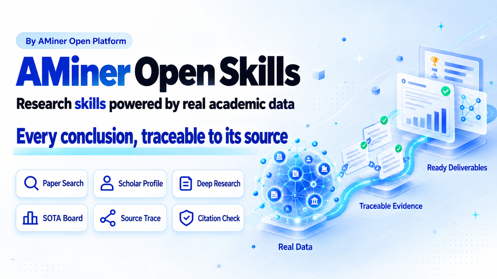

<div align="center">
  <h1>AMiner Open Skills</h1>
  <p>
    
  </p>
  <p>
    <a href="LICENSE"></a>
    <a href=".claude-plugin/marketplace.json"></a>
    <a href="#2-installation"></a>
    <a href="#3-skill-index"></a>
    <a href="README.zh.md"></a>
  </p>
  <p>
    <a href="https://www.aminer.cn/">Website</a>
    · <a href="#2-installation">Install</a>
    · <a href="#1-quick-start">Quick Start</a>
    · <a href="#3-skill-index">Skill Index</a>
    · <a href="https://open.aminer.cn/open/docs">Open Platform Docs</a>
    · <a href="#4-design-principles-and-repository-layout">Design Principles</a>
    · <a href="README.zh.md">中文</a>
  </p>
  <p>
    <b>AMiner web app: Smart Search, AI Reading, Res Labs, AI2000 and more built in — visit <a href="https://www.aminer.cn">https://www.aminer.cn</a></b>
  </p>
</div>

---

`aminer-open-skill` collects reusable research skills built on AMiner academic data for the full research lifecycle, emphasizing real academic data, verifiable evidence chains, and directly usable research artifacts.

## Contents

- [1. Quick Start](#1-quick-start)
- [2. Installation](#2-installation)
  - [2.1 `npx skills` (recommended)](#21-npx-skills-recommended)
  - [2.2 Claude Code plugin](#22-claude-code-plugin)
  - [2.3 Manual install (Codex / OpenClaw / other agents)](#23-manual-install-codex--openclaw--other-agents)
  - [2.4 Python dependencies](#24-python-dependencies)
  - [2.5 Configure the token when required](#25-configure-the-token-when-required)
  - [2.6 Token and billing notes](#26-token-and-billing-notes)
- [3. Skill Index](#3-skill-index)
  - [3.1 Skills by research stage](#31-skills-by-research-stage)
  - [3.2 Choosing between similar skills](#32-choosing-between-similar-skills)
  - [3.3 Full skill list](#33-full-skill-list)
- [4. Design Principles and Repository Layout](#4-design-principles-and-repository-layout)
- [5. Feedback and Contact](#5-feedback-and-contact)
- [6. Star History](#6-star-history)

## 1. Quick Start

Once installed and configured with a token where needed (see [2. Installation](#2-installation)), hand your papers, topics, reviewer comments, or task descriptions straight to the agent. The prompts below can be copied as-is:

| What you want | Just say this |
|---|---|
| Quick paper lookup | `Find 10 recent papers on long-context language models. Return the title, year, venue, citation count, and URL.` (`aminer-free-academic`) |
| Investigate a scholar or topic | `Build a research profile for Andrew Ng, including interests, representative papers, collaborators, and recent work.` (`aminer-academic-search`) |
| Retrieve structured experiments | `Return the original Experiment JSON for this paper, filtered by method and dataset name.` (`aminer-academic-search`) |
| Get a focused reading list | `Recommend 8 papers on tool-using multimodal agents, prioritizing recent and highly cited work.` (`aminer-daily-paper`) |
| Collect literature for a survey | `Collect 200 candidate papers on retrieval-augmented generation, expand from strong seed papers, remove duplicates, and export the bibliography.` (`aminer-deep-search`) |
| Organize a paper collection | `Group these paper titles and abstracts into a coherent hierarchical taxonomy and save it as taxonomy.md.` (`scientific-taxonomy`) |
| Produce a sourced research report | `Research the Chinese LLM industry and write a cited report with an evidence ledger backing every claim.` (`deep-research`) |
| Find SOTA and build a leaderboard | `Find the current DocVQA SOTA, separate incompatible evaluation scopes, and return a sourced leaderboard with the standard artifact bundle.` (`sota-finder`) |
| Trace a paper's sources | `Analyze this PDF. Trace each key claim to its citation context and source, explain the citation intent, and generate the Markdown, JSON, SVG, and HTML outputs.` (`paper-source-trace`) |
| Parse a PDF and extract experiments | `OCR this paper PDF, convert it to Markdown, and extract the experiment methods, datasets, and metrics as JSON.` (`aminer-pdf-ocr`) |
| Extract experiments from Markdown | `Read this paper's Markdown file and extract the experiment methods, datasets, metrics, and key results as one JSON file.` (`aminer-exp-extraction`) |
| Detect fabricated references | `Check every reference in this paper PDF and flag entries that are missing, suspicious, or need manual review.` (`pdf-citation-verifier`) |
| Audit parsed bibliography entries conservatively | `Parse this PDF into a reference ledger, then resolve each eligible reference through AMiner without treating an unresolved match as fabrication.` (`structured-reference-audit`) |
| Check citation faithfulness | `For each in-text citation in this paper, retrieve the cited source and determine whether the surrounding claim is supported by the original text.` (`citation-faithfulness`) |

If you are not sure which skill fits, just describe the task; if you already know the name, state it explicitly, e.g. "use `aminer-free-academic`". When installed as a [Claude Code plugin](#22-claude-code-plugin), skills with a `commands/` directory can also be invoked as slash commands (plugin commands carry the plugin-name prefix):

```text
/aminer-deep-search:aminer-deep-search topic: "multimodal agents" target-size: 200
```

## 2. Installation

Every directory under `skills/` is an independently installable skill. Whichever method you use, keep the full skill directory (`SKILL.md`, `scripts/`, `references/`, etc.) — do not copy `SKILL.md` alone. Then configure the token as described in [2.5](#25-configure-the-token-when-required).

| Your environment | Recommended method |
|---|---|
| Claude Code, Codex, OpenClaw, Cursor, Trae, and other mainstream agents | [2.1 `npx skills`](#21-npx-skills-recommended) |
| Claude Code, with slash commands | [2.2 Plugin](#22-claude-code-plugin) |
| No network install, or a pinned version | [2.3 Manual install](#23-manual-install-codex--openclaw--other-agents) |

### 2.1 `npx skills` (recommended)

Requires [Node.js 18 or later](https://nodejs.org/); no global CLI install needed. List the installable skills first:

```bash
npx skills add AMinerOrg/aminer-open-skill --list
```

Install into the current project (omit `--global`) or for your user (add `--global`). `--agent` accepts values such as `claude-code`, `codex`, `openclaw`, `cursor`, `trae`:

```bash
# Free entry point only, into the current project's Claude Code
npx skills add AMinerOrg/aminer-open-skill --agent claude-code --skill aminer-free-academic --yes

# Several skills, globally for Codex
npx skills add AMinerOrg/aminer-open-skill --global --agent codex \
  --skill aminer-free-academic --skill aminer-academic-search --yes

# Every skill
npx skills add AMinerOrg/aminer-open-skill --global --agent claude-code --skill '*' --yes
```

List and update:

```bash
npx skills list --global
npx skills update --global --yes
```

`npx skills` manages skill files only — see [2.4](#24-python-dependencies) for Python dependencies; slash commands require the [2.2 plugin install](#22-claude-code-plugin).

### 2.2 Claude Code plugin

The repository ships a plugin manifest, [`.claude-plugin/marketplace.json`](.claude-plugin/marketplace.json) (marketplace name `aminer-open-skills`), with one plugin per skill. In Claude Code, run:

```text
/plugin marketplace add AMinerOrg/aminer-open-skill
/plugin install aminer-free-academic@aminer-open-skills
```

For other skills, replace `aminer-free-academic` with a name from the [skill list](#33-full-skill-list), or run only the first line and pick plugins in the `/plugin` UI. To pull new versions:

```text
/plugin marketplace update aminer-open-skills
```

The plugin install also registers each skill's slash commands (its `commands/` directory). They carry the plugin-name prefix, e.g. `/aminer-daily-paper:aminer-dp`, `/aminer-deep-search:aminer-deep-search`.

### 2.3 Manual install (Codex / OpenClaw / other agents)

```bash
git clone https://github.com/AMinerOrg/aminer-open-skill.git ~/ai-skills/aminer-open-skill
```

Put each selected `skills/<skill-name>/` directory, whole, into your agent's skill directory:

| Agent | User-level skill directory | Project-level skill directory |
|---|---|---|
| Claude Code | `~/.claude/skills/` | `<project>/.claude/skills/` |
| Codex | `~/.codex/skills/` | — |
| OpenClaw and other agents | see their docs | see their docs |

Prefer symlinks over copies, so a `git pull` in the clone updates the skills:

```bash
ln -s ~/ai-skills/aminer-open-skill/skills/aminer-free-academic ~/.codex/skills/aminer-free-academic
```

Manual installs do not register slash commands (command files depend on the plugin variable `CLAUDE_PLUGIN_ROOT`); trigger skills with natural language instead.

### 2.4 Python dependencies

Skill scripts need `python3`. Most skills use only the standard library; the following need extra packages:

| Skill | Dependencies |
|---|---|
| `aminer-daily-paper` | PyYAML |
| `aminer-pdf-ocr` | requests, pypdf |
| `aminer-exp-extraction` / `pdf-citation-verifier` / `structured-reference-audit` | requests |
| `deep-research` | matplotlib (report figures) |
| `sota-finder` | openpyxl (Excel export) |

```bash
python3 -m pip install -r skills/<skill-name>/requirements.txt
```

`structured-reference-audit` also needs a reachable [GROBID](https://github.com/kermitt2/grobid) service or existing TEI files.

### 2.5 Configure the token when required

Generate a token in the [AMiner Console](https://open.aminer.cn/open/board?tab=control), then set `AMINER_API_KEY` in the environment used by your assistant:

```bash
export AMINER_API_KEY="<YOUR_TOKEN>"
```

For local Claude Code, Codex, and similar conversational sessions, the repository provides quick setup tools:

```text
Windows:       tools\setup-aminer-token.cmd
PowerShell:    .\tools\setup-aminer-token.ps1
macOS/Linux:   ./tools/setup-aminer-token.sh
```

OpenClaw uses its own environment configuration:

```bash
openclaw config set env.vars.AMINER_API_KEY "<YOUR_TOKEN>"
```

Standalone CLI commands, CI jobs, and scheduled tasks must set the token where the command runs. Not every skill requires a token — check the Token column of the [skill list](#33-full-skill-list) first.

### 2.6 Token and billing notes

- Never print, log, or commit `AMINER_API_KEY`.
- `aminer-exp-extraction` calls the Zhipu BigModel API instead: set `BIGMODEL_API_KEY` for it (`OPENAI_API_KEY` accepted as fallback). It never uses the AMiner token.
- Free AMiner APIs still require a token. Start with `aminer-free-academic` before using paid APIs.
- Some tasks may incur API charges. Review the estimated cost before approving large searches or expensive calls.
- The setup tools under `tools/` configure local chat sessions only. Set the token separately for OpenClaw, CLI, CI, and scheduled jobs.
- For direct API integration rather than Skill usage, see the [AMiner Open Platform documentation](https://open.aminer.cn/open/docs).

## 3. Skill Index

### 3.1 Skills by research stage

| Stage | Skills |
|---|---|
| Search and discovery | `aminer-free-academic` · `aminer-academic-search` · `aminer-daily-paper` · `aminer-deep-search` · `sota-finder` |
| Reading and organizing | `aminer-pdf-ocr` · `aminer-exp-extraction` · `scientific-taxonomy` · `paper-source-trace` |
| Research reports | `deep-research` |
| Citation checking | `pdf-citation-verifier` · `structured-reference-audit` · `citation-faithfulness` |

### 3.2 Choosing between similar skills

| You want | Use | Not |
|---|---|---|
| A single-step lookup of papers, scholars, institutions, venues, or patents, at zero cost | `aminer-free-academic` | `aminer-academic-search` (only for full abstracts, scholar careers, citation relations, or combined workflows) |
| A list of hundreds of candidate papers, no report | `aminer-deep-search` | `deep-research` |
| A cited research report backed by an evidence ledger | `deep-research` | `aminer-deep-search` |
| A few personalized reading recommendations | `aminer-daily-paper` | `aminer-deep-search` |
| A direct verdict on whether references exist | `pdf-citation-verifier` | `structured-reference-audit` |
| A conservative reference audit where "unresolved" is not "fabricated" | `structured-reference-audit` | `pdf-citation-verifier` |
| Whether a citation faithfully represents the cited source | `citation-faithfulness` | `pdf-citation-verifier` |
| Tracing claims to sources and citation intent, with a citation map | `paper-source-trace` | `citation-faithfulness` |
| Input is a PDF | `aminer-pdf-ocr` | `aminer-exp-extraction` (only when the input is already Markdown) |

### 3.3 Full skill list

`skills/` currently contains the following 13 triggerable skills. Click a skill name for the full skill definition.

| Skill | Status | Purpose | Triggers | Token |
| --- | --- | --- | --- | --- |
| [`aminer-free-academic`](skills/aminer-free-academic/SKILL.md) | Stable | Free-tier academic lookup and discovery (7 free APIs, zero cost) | "find this paper by title", "this scholar's interests and citations", "is this venue a conference or journal", "patent trend scan" | Free APIs, token still required |
| [`aminer-academic-search`](skills/aminer-academic-search/SKILL.md) | Stable | Full academic data queries and analysis across papers, scholars, institutions, venues, and patents, plus structured experiment retrieval (29 APIs + 6 workflows) | "build a full scholar profile", "paper deep dive", "multi-condition / semantic paper search", "return the Experiment JSON" | Required; some APIs billed; experiment retrieval ¥0.10/call |
| [`aminer-daily-paper`](skills/aminer-daily-paper/SKILL.md) | Stable | Personalized paper recommendations by topic, scholar profile, or author, with Feishu card and Markdown output | "recommend 8 recent highly-cited papers on X", "personalized reading list" | Required |
| [`aminer-deep-search`](skills/aminer-deep-search/SKILL.md) | Stable | Large survey bibliography collection via multi-round search, deduplication, and citation snowballing | "collect 200 candidate papers for a survey", "snowball from seed papers" | Required |
| [`deep-research`](skills/deep-research/SKILL.md) | Stable | Deep research producing a cited, hierarchically numbered report plus a reusable Evidence Ledger | "research the X industry and write a cited report", "literature-review style investigation" | Required; free-first, billed APIs capped (¥20 hard stop) |
| [`sota-finder`](skills/sota-finder/SKILL.md) | Stable | Find recent or historical SOTA, separate comparable scopes, and build practical leaderboards with structured artifacts | "what's the current SOTA on X", "split incomparable scopes and build a leaderboard" | Optional; only for AMiner enrichment |
| [`scientific-taxonomy`](skills/scientific-taxonomy/SKILL.md) | Stable | Build a hierarchical Markdown taxonomy from paper titles and abstracts | "organize these papers into a coherent taxonomy" | Optional; only when AMiner fills missing metadata |
| [`paper-source-trace`](skills/paper-source-trace/SKILL.md) | Stable | Trace a paper's key claims to citation contexts and sources, with intent analysis and SVG/HTML citation maps | "trace key claims to their sources", "explain the citation intent", "generate a citation map" | Optional; only for AMiner enrichment |
| [`aminer-pdf-ocr`](skills/aminer-pdf-ocr/SKILL.md) | Stable | Convert a paper PDF to full-text Markdown via the AMiner OCR service, then extract structured experiment info with the built-in prompt | "convert this PDF to Markdown", "OCR it and extract methods / datasets / metrics" | Required |
| [`aminer-exp-extraction`](skills/aminer-exp-extraction/SKILL.md) | Stable | Extract experiment JSON (methods, datasets, metrics, key results) from paper Markdown via a two-stage GLM pipeline | "extract methods / datasets / metrics / key results from this paper's Markdown" | Requires `BIGMODEL_API_KEY`; no AMiner token |
| [`pdf-citation-verifier`](skills/pdf-citation-verifier/SKILL.md) | Stable | Upload a paper PDF and verify every listed reference actually exists; detects hallucination | "are the references in this PDF fabricated", "find fake citations" | Required |
| [`structured-reference-audit`](skills/structured-reference-audit/SKILL.md) | Stable | Build a GROBID-backed reference ledger, then conservatively resolve each entry through AMiner, keeping resolution uncertainty separate from existence | "conservatively audit the references", "turn this PDF into a reference ledger and resolve each entry" | AMiner resolution needs a token; GROBID or TEI required |
| [`citation-faithfulness`](skills/citation-faithfulness/SKILL.md) | Stable | Check whether each in-text citation accurately represents what the cited source says (supported / partial / distortion / not found / unverifiable) | "does the paper misrepresent its references", "does citation [12] actually support this claim" | No AMiner token; web access required |

## 4. Design Principles and Repository Layout

### 4.1 Shared design principles

Every skill in this repository follows these principles:

1. **Citation-integrity red line**: only write what was actually retrieved — say "not found" rather than fabricating; every result carries a three-state marker (verified / uncertain / not found).
2. **Academic data first**: queries about papers, scholars, institutions, venues, or patents go through the AMiner Open Platform first; free endpoints first, billed calls estimated before execution.
3. **Triage before action**: similar-looking requests are different task types; classify first, then follow the output contract for that type.
4. **Complete first answer**: the first reply delivers the full artifact for the request type instead of relying on clarifying questions.
5. **Fail loudly**: zero-output silent failures never happen; failures keep the submitted materials, and resending the same message resumes from the breakpoint.
6. **Deliveries carry next steps**: every delivery ends with continuations — dimensions, todos, or the next section.
7. **Parse and echo constraints**: word counts, item counts, year windows, and templates written into an instruction are acceptance criteria; parse and echo them before writing, and state any unfilled quota.
8. **Cross-session state**: returning to the same manuscript, project, or list weeks later is normal; continue incrementally instead of rewriting from scratch.
9. **Artifacts over hearsay**: guide users to paste their real materials (drafts, data, comments, templates) — judge by what was pasted, not what was said.

### 4.2 Repository layout

```text
aminer-open-skill/
├── .claude-plugin/marketplace.json   # Claude plugin manifest
├── tools/                            # quick token-setup scripts for local sessions
└── skills/
    ├── <skill-name>/
    │   ├── SKILL.md                  # skill definition: frontmatter + rules + workflow, loaded by the agent on trigger
    │   ├── SKILL.zh.md               # Chinese mirror (where provided)
    │   ├── commands/                 # slash commands (where provided)
    │   ├── scripts/                  # tool scripts calling the AMiner Open Platform
    │   ├── references/               # prompts and reference rules
    │   ├── evals/                    # evaluation samples
    │   └── requirements.txt
    └── ...
```

### 4.3 About contributions

The skills in this repository are currently maintained internally by the AMiner team, and new skills are not accepted from outside contributors for now. Feedback and feature requests are welcome via [GitHub Issues](https://github.com/AMinerOrg/aminer-open-skill/issues).

## 5. Feedback and Contact

- Usage questions and bugs: [GitHub Issues](https://github.com/AMinerOrg/aminer-open-skill/issues)
- Email: [report@aminer.cn](mailto:report@aminer.cn)
- API access and billing: [AMiner Open Platform](https://open.aminer.cn/open/docs)

## 6. Star History

[](https://star-history.com/#AMinerOrg/aminer-open-skill&Date)

## References

- [AMiner Console](https://open.aminer.cn/open/board?tab=control)
- [AMiner Open Platform Documentation](https://open.aminer.cn/open/docs)
- [Claude plugin list](.claude-plugin/marketplace.json)
- [MIT License](LICENSE)
